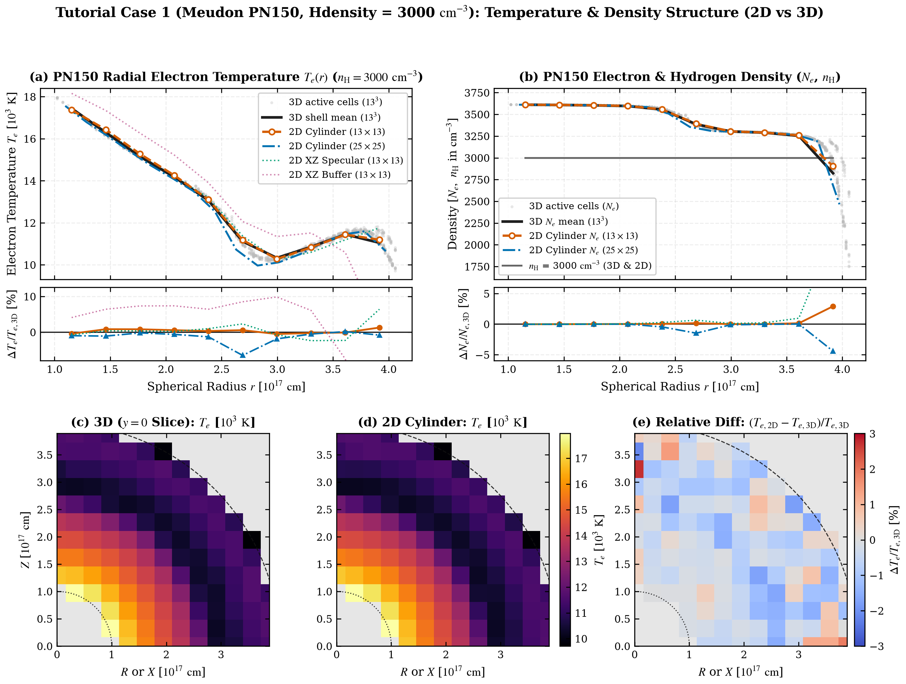
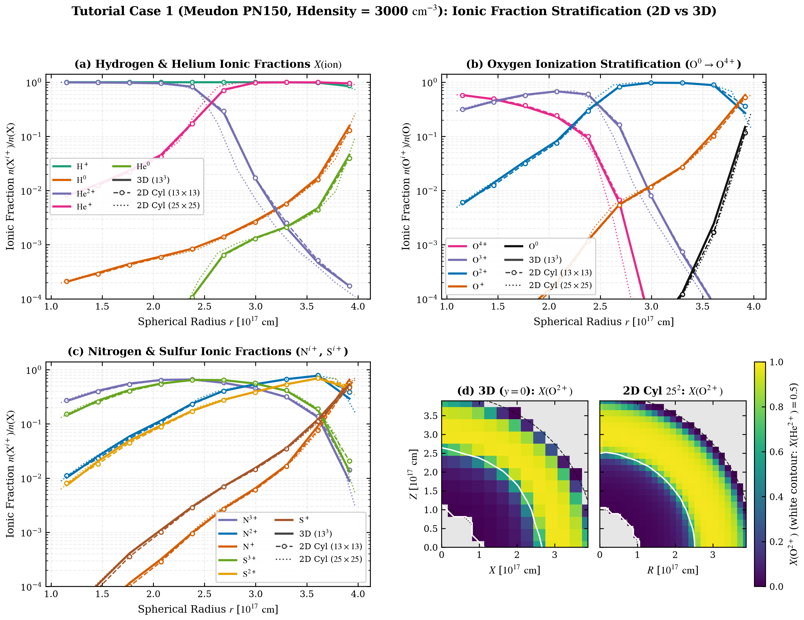
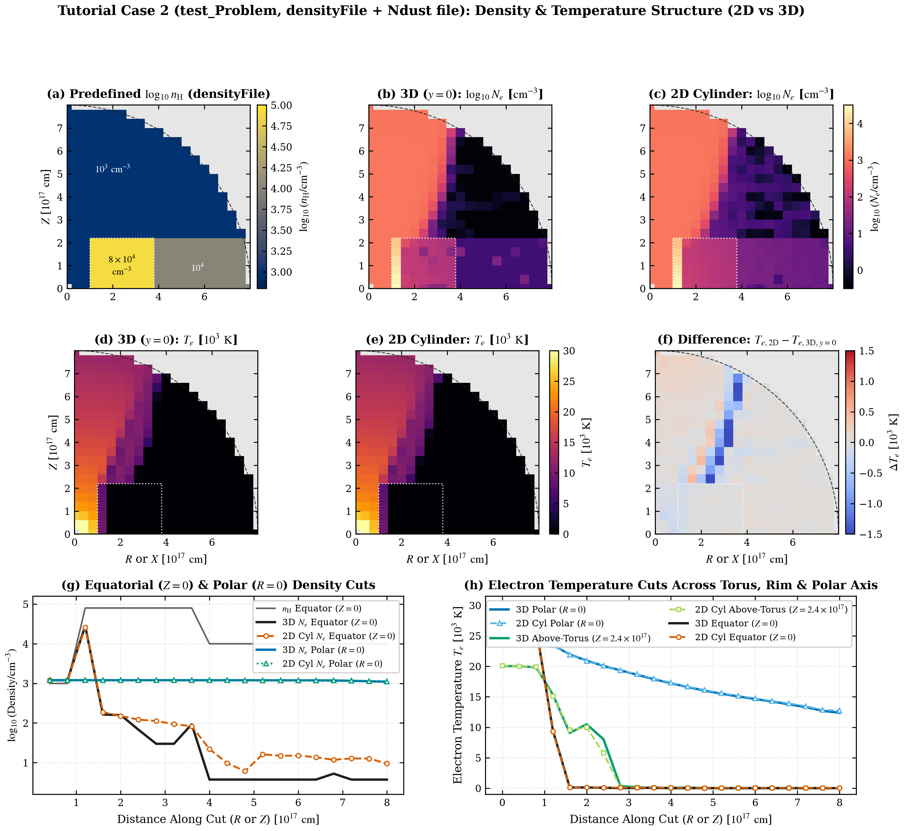
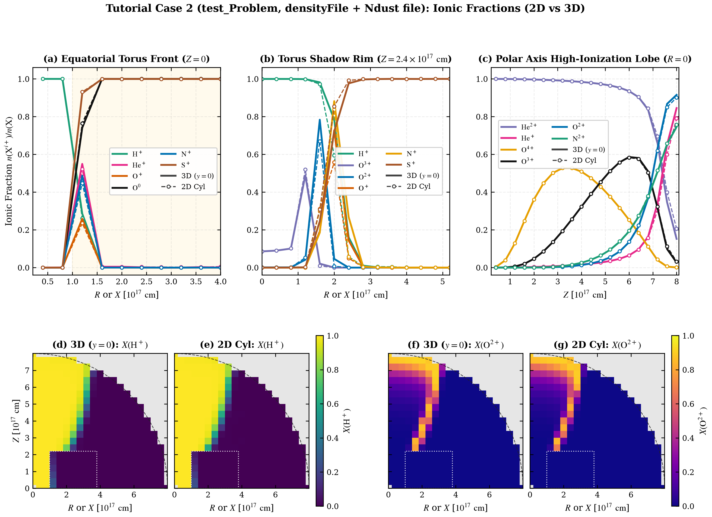

# Running Axisymmetric 2D Models in MOCASSIN

MOCASSIN's **2D mode** reduces an $N_x \times N_y \times N_z$ Cartesian radiation-transfer grid to a meridional cross-section ($N_x \times 1 \times N_z$), cutting memory usage and Monte Carlo runtime by **2x–3x** at matched spatial resolution — or allowing **2x finer radial and vertical resolution** ($25 \times 25$ vs. $13^3$) in less wall-clock time than the coarse 3D grid while improving per-cell photon packet statistics.

This tutorial covers:

1. [Available 2D Geometry Modes & Rules](#1-available-2d-geometry-modes--rules)
2. [Building & Preparing a Simulation Directory](#2-building--preparing-a-simulation-directory)
3. [Tutorial Case 1 — Constant Density via `Hdensity` (`PN150`)](#3-tutorial-case-1--constant-density-via-hdensity-pn150)
4. [Tutorial Case 2 — Predefined Density & Dust Grids via `densityFile` & `Ndust file` (`test_Problem`)](#4-tutorial-case-2--predefined-density--dust-grids-via-densityfile--ndust-file-test_problem)
5. [Generating 2D vs. 3D Comparison Plots (`tools/plot_2d_tutorial_comparisons.py`)](#5-generating-2d-vs-3d-comparison-plots-toolsplot_2d_tutorial_comparisonspy)

---

## 1. Available 2D Geometry Modes & Rules

Enable 2D mode by adding a single `2D` directive to `input/input.in`. In [`source/set_input_mod.f90`](source/set_input_mod.f90), MOCASSIN parses:

```text
2D <plane> <symmetry_or_closure> [<closure>]
```

| Keyword in `input.in` | Internal Physics (`common_mod` flags) | Geometry & Photon Transport | When to Use |
| :--- | :--- | :--- | :--- |
| **`2D XZ Z cylinder`** *(Recommended)* | `lgCylinder2D = .true.` | **True Axisymmetric Cylindrical Monte Carlo:** Continuous 3D straight-line photon transport $(x, y, z)$ mapped onto cylindrical rings $R = \sqrt{x^2+y^2}$ and vertical layers $Z$, with exact toroidal ring volumes, quadratic radial wall intersections, curved-ray `resLinesTransfer`, and toroidal slit projections. | **Default choice for all science runs** (planetary nebulae, bipolar outflows, disks/tori, dusty or gas-only models, multi-inclination SEDs). |
| `2D XZ Z buffer` *(or bare `2D XZ` / `2D XZ Z`)* | `lgBuffer2D = .true.` | Planar Cartesian slice with perpendicular thickness $\Delta_\perp$ and a statistical ghost-buffer boundary that samples `scaOpac/opacity`, optically thin cooling (`totalLines`), and `recPDF`/`dustPDF` before returning continuum packets inward. | Diagnostic comparisons of planar closure schemes (underestimates global $H\beta$ by ~17%–26% on open nebulae due to perpendicular cooling escape). |
| `2D XZ Z specular` | `lgSpecular2D = .true.` | Planar Cartesian slice where primary stellar photons escape across `minPerp2D`/`maxPerp2D` (preserving $1/R^2$ dilution) while diffuse photons undergo specular mirror reflection at the slice faces. | Soft-SED diagnostics where diffuse trapping compensates slice losses (over-ionizes low-ionization outer zones in hard-SED nebulae). |
| `2D XZ Z noSpecular` | All planar closure flags `.false.` | Open thin Cartesian slab: both stellar and diffuse photons escape freely across `minPerp2D`/`maxPerp2D`. | Ablation / sanity diagnostic only (loses ~23%–33% of diffuse trapping & $H\beta$ power). |

### Key Coordinate & Startup Constraints

1. **Orientation (`cylinder`):** `2D XZ Z cylinder` strictly requires the `XZ` plane with symmetry axis `Z` (`xAxis` $= R \ge 0$, `zAxis` $= Z$, collapsed `yAxis(1) = 0`, `ny = 1`), and at least $2 \times 2$ grid points (`nx >= 2`, `nz >= 2`). Aliases `cylindrical` and `axisymmetric` are also accepted.
2. **Equatorial Reflection Symmetry (`symmetricXYZ`):**
   - **With `symmetricXYZ`:** MOCASSIN models the $R \ge 0$, $Z \ge 0$ quadrant ($V_{\mathrm{oct}} = \frac{\pi}{4}(R_{\mathrm{out}}^2 - R_{\mathrm{in}}^2)\Delta Z$), with the outer boundary walls at $R_{n_x}$ and $Z_{n_z}$ half-width, multiplying all volume/luminosity integrals by `8` (`MC` estimators divide `JSte`, `JDif`, and `escapedPackets` by `8` in `iteration_mod.f90`) to recover full $2\pi$ azimuth across both $+Z$ and $-Z$ hemispheres.
   - **Without `symmetricXYZ`:** MOCASSIN models the full north–south meridional half-plane $R \in [0, R_{n_x}]$, $Z \in [-Z_{\max}, +Z_{\max}]$ ($V_{\mathrm{hemi}} = \pi(R_{\mathrm{out}}^2 - R_{\mathrm{in}}^2)\Delta Z$, full $2\pi$ azimuth). Automatic grids without `symmetricXYZ` require an **odd** `nz` so a grid plane lies at $Z = 0$.
3. **Axisymmetric Source Placement:** For `2D XZ Z cylinder`, ionizing photon sources (`starPosition`) must lie on the symmetry axis ($x_* = y_* = 0$). Off-axis point sources break axisymmetry and are rejected at startup.
4. **Incompatible Options:** `2D` is incompatible with `echo` (light echoes) and `planeIonization`. Additionally, `2D XZ Z cylinder` cannot currently be combined with `fluorescence` or nested `multiGrids` (`nGrids > 1`).

---

## 2. Building & Preparing a Simulation Directory

### Compiling the Executables

From the repository root (`/home/hmonteiro/software/mocassin_HM_2026`), build single-threaded using:

```bash
make clean && make all
```

This builds four executables:
- `./mocassin` — primary MPI Monte Carlo solver
- `./mocassinWarm` — warm-start continuation from saved `output/grid*.out`
- `./mocassinOutput` — re-runs gas/dust/SED output synthesis from `output/grid*.out`
- `./mocassinPlot` — generates 3D/2D spatial emission cubes (`grid4.out` / `plot.out`)

### Atomic & Dust Data Paths

Verify where `make install` places the atomic data (`data/`) and grain optical constants (`dustData/`). By default on Linux (`Makefile`), `PREFIX=$(HOME)/.local`, so MOCASSIN looks for atomic data files under `$(PREFIX)/share/mocassin/data/`. If your `~/.local/share/mocassin/` directory is not populated yet, install the bundled data once:

```bash
make install
```

Additionally, dust models whose `dust_species.dat` references relative paths such as `'dustData/astroSilD2003_base.nk'` look for `dustData/` inside the **simulation working directory**, so symlink it when running a dusty model:

```bash
ln -s /path/to/mocassin_HM_2026/dustData ./dustData
```

---

## 3. Tutorial Case 1 — Constant Density via `Hdensity` (`PN150`)

Our first case uses the standard **Meudon PN150** planetary nebula benchmark (`benchmarks/gas/PN150/`): a $T_* = 150\,000\,\mathrm{K}$ blackbody central star inside a constant-density homogeneous hydrogen shell ($n_{\mathrm{H}} = 3\,000\,\mathrm{cm}^{-3}$, $R_{\mathrm{in}} = 1.0 \times 10^{17}\,\mathrm{cm}$, $R_{\mathrm{out}} = 4.07 \times 10^{17}\,\mathrm{cm}$, cubic outer edge `3.888e17 cm`).

### Step 3.1: Set Up the Run Directories

Create side-by-side 3D and 2D working directories from the benchmark inputs:

```bash
REPO=/home/hmonteiro/software/mocassin_HM_2026

mkdir -p tutorial_runs/PN150_3D/{input,output}
mkdir -p tutorial_runs/PN150_2D_cylinder/{input,output}
mkdir -p tutorial_runs/PN150_2D_cylinder_res2x/{input,output}

cp "$REPO/benchmarks/gas/PN150/abunPN150.in" tutorial_runs/PN150_3D/input/
cp "$REPO/benchmarks/gas/PN150/input.in"     tutorial_runs/PN150_3D/input/

cp "$REPO/benchmarks/gas/PN150/abunPN150.in" tutorial_runs/PN150_2D_cylinder/input/
cp "$REPO/benchmarks/gas/PN150/abunPN150.in" tutorial_runs/PN150_2D_cylinder_res2x/input/
```

### Step 3.2: Configure `input/input.in`

To convert the 3D `PN150` input file to **True Axisymmetric Cylindrical 2D**, simply prepend `2D XZ Z cylinder`. Notice that `ny 13` can remain in `input.in` — MOCASSIN automatically records `nyIn3D = 13` and collapses `ny = 1` onto `yAxis(1) = 0`:

```text
2D XZ Z cylinder
autoPackets 0.20 2. 10000000
TStellar 150000.
output
symmetricXYZ
Hdensity 3000.
TeStart 12000.
contShape  blackbody
nebComposition "input/abunPN150.in"
maxIterateMC  10 95.
nPhotons 1000000
nx 13
ny 13
nz 13
nbins 700
LPhot 5.42e11
nuMax 24.
nuMin 1.001e-5
Rin 1.e17
Rout 4.07e17
edges 3.888e17 3.888e17 3.888e17
convLimit 0.05
```

For the **2x higher-resolution** run (`PN150_2D_cylinder_res2x`), set `nx 25` and `nz 25` (yielding $25 \times 1 \times 25 = 625$ total nodes and $485$ active radial/polar cells, still $3.5\times$ fewer nodes than the coarse $13^3$ 3D grid!). *(Tip: when doubling spatial resolution along each axis, increase the `autoPackets` cap — e.g. `autoPackets 0.20 2. 20000000` — if you want >90% cell convergence at iteration 10; with the default $10^7$ cap, $25 \times 25$ finishes at 70.7% converged cells while still matching $H\beta$ and $[\text{O III}]$ to within $0.9\%$.)*

### Step 3.3: Run the Simulations

Execute each simulation from inside its working directory (wait until each MPI run finishes before starting the next):

```bash
(cd tutorial_runs/PN150_3D && mpirun -np 14 "$REPO/mocassin" | tee run.log)
(cd tutorial_runs/PN150_2D_cylinder && mpirun -np 14 "$REPO/mocassin" | tee run.log)
(cd tutorial_runs/PN150_2D_cylinder_res2x && mpirun -np 14 "$REPO/mocassin" | tee run.log)
```

### Step 3.4: Quantitative 3D vs. 2D Benchmark Comparison (`PN150`)

The table below compares verified runs executed on **14 OpenMPI ranks** on the post-audit codebase (`c1d1c36`):

| Observable | 3D (`13x13x13`) | `2D XZ Z cylinder` (`13x13`) | `Cyl 13` vs 3D | `2D XZ Z cylinder` (`25x25`) | `Cyl 25` vs 3D | `2D XZ Z specular` (`13x13`) | `2D XZ Z buffer` (`13x13`) |
| :--- | :---: | :---: | :---: | :---: | :---: | :---: | :---: |
| **Runtime [14 MPI]** | `11.94 s` | **`4.12 s`** | **`2.90x` faster** | **`7.17 s`** | **`1.67x` faster** | `3.54 s` | `4.56 s` |
| **Active Gas Cells** | `1,203` | `126` | — | `485` | — | `126` | `126` |
| **Gas Mass** ($M_\odot$) | `0.9770` | `0.9625` | `-1.48%` | `0.9699` | `-0.72%` | `0.9625` | `0.9625` |
| **$H\beta$** ($10^{36}\text{ erg s}^{-1}$) | **`0.2682`** | **`0.2654`** | **`-1.06%`** | **`0.2658`** | **`-0.89%`** | `0.2780` (`+3.65%`) | `0.1973` (`-26.4%`) |
| **$\langle T_e(\mathrm{H}^+)\rangle$** (K) | **`11,927`** | **`11,941`** | **`+0.11%`** | **`11,807`** | **`-1.01%`** | `11,934` (`+0.06%`) | `12,741` (`+6.8%`) |
| **$\langle T_e(\mathrm{He}^{2+})\rangle$** (K) | **`14,219`** | **`14,222`** | **`+0.02%`** | **`14,351`** | **`+0.93%`** | `14,153` (`-0.46%`) | `14,993` (`+5.4%`) |
| **He I 5876** ($/H\beta$) | `0.1186` | `0.1179` | `-0.64%` | `0.1218` | `+2.63%` | `0.1161` | `0.1106` |
| **He II 4686** ($/H\beta$) | `0.2829` | `0.2862` | `+1.17%` | `0.2577` | `-8.92%` | `0.2836` | `0.3754` |
| **[O III] 5008** ($/H\beta$) | `16.7520` | `16.9616` | `+1.25%` | **`16.6835`** | **`-0.41%`** | `19.1937` | `16.9589` |
| **[O II] 3726** ($/H\beta$) | `0.8898` | `0.8273` | `-7.03%` | `0.7947` | `-10.69%` | `0.2885` (`-67.6%`) | `1.1333` |
| **[O I] 6300+6363** ($/H\beta$) | `0.1520` | `0.1293` | `-14.90%` | **`0.1454`** | **`-4.32%`** | `0.0087` (`-94.3%`) | `0.3552` |
| **[N II] 6584** ($/H\beta$) | `0.8869` | `0.8078` | `-8.91%` | `0.7776` | `-12.32%` | `0.2189` (`-75.3%`) | `1.2133` |
| **[S II] 6717** ($/H\beta$) | `0.2579` | `0.2374` | `-7.95%` | `0.2416` | `-6.30%` | `0.0884` (`-65.7%`) | `0.4339` |
| **[O II] 3729/3726** | `1.7300` | `1.7347` | `+0.28%` | `1.7278` | `-0.12%` | `1.7670` | `1.7015` |
| **[S II] 6731/6717** | `1.4474` | `1.4471` | `-0.02%` | `1.4309` | `-1.14%` | `1.4821` | `1.3618` |

### Step 3.5: Comparing $T_e$, $N_e$, and Ionic Fractions (`PN150` Plots)



- **Electron temperature ($T_e$, panel a & maps c–e):** `2D XZ Z cylinder` tracks the 3D spherical-shell mean from the hot inner $\mathrm{He}^{2+}$ core ($T_e \approx 17.4\text{--}18.0 \times 10^3\,\mathrm{K}$ near $R_{\mathrm{in}} = 1.0 \times 10^{17}\,\mathrm{cm}$) through the $\mathrm{He}^{2+} \to \mathrm{He}^+$ thermal dip at $r \approx 3.0 \times 10^{17}\,\mathrm{cm}$ ($T_e \approx 10.3 \times 10^3\,\mathrm{K}$) out to the outer $[\text{O III}]/[\text{O II}]$ cooling boundary within **$\pm 1\%$** at $13 \times 13$. Contrast this with the planar closures: `2D XZ Specular` captures $T_e$ well in the core but diverges in the low-ionization outer shell due to diffuse EUV photon trapping, while `2D XZ Buffer` sits $+6\%$ to $+9\%$ hotter throughout due to perpendicular continuum losses.
- **Hydrogen & electron density ($n_{\mathrm{H}}$ & $N_e$, panel b):** `Hdensity 3000.` sets a uniform $n_{\mathrm{H}} = 3\,000\,\mathrm{cm}^{-3}$ across all active cells (`[Rin, Rout]`). Inside $r \lesssim 2.4 \times 10^{17}\,\mathrm{cm}$, doubly ionized He (`He/H = 0.10`) boosts $N_e \approx 3\,610\,\mathrm{cm}^{-3}$; between $r \approx 2.4\text{--}3.0 \times 10^{17}\,\mathrm{cm}$, $\mathrm{He}^{2+} \to \mathrm{He}^+$ shifts $N_e$ smoothly down to $\approx 3\,300\,\mathrm{cm}^{-3}$, before hydrogen recombination drops $N_e$ below $3\,000\,\mathrm{cm}^{-3}$ right at $r \to R_{\mathrm{out}}$.



- **Ionic stratification (panels a–d):** Every ionization front — $\mathrm{H}^0 / \mathrm{H}^+$, $\mathrm{He}^{2+} / \mathrm{He}^+ / \mathrm{He}^0$, $\mathrm{O}^{4+} \to \mathrm{O}^{3+} \to \mathrm{O}^{2+} \to \mathrm{O}^+ \to \mathrm{O}^0$, and the $\mathrm{N}$/$\mathrm{S}$ ionization ladders — matches the 3D benchmark closely across 4 orders of magnitude. Doubling the 2D resolution to $25 \times 25$ sharpens the thin outer neutral skin ($\mathrm{O}^0$ and $\mathrm{H}^0$ rising steeply at $r > 3.6 \times 10^{17}\,\mathrm{cm}$), closing the $[\text{O I}]\,(6300+6363)$ discrepancy vs. 3D from $-14.9\%$ to **$-4.32\%$** in only `7.17 s`.

---

## 4. Tutorial Case 2 — Predefined Density & Dust Grids via `densityFile` & `Ndust file` (`test_Problem`)

Real nebulae often contain equatorial tori, bipolar cavities, or abundance/dust components that cannot be written as an analytic radial law. Our second case uses **`benchmarks/test_Problem/`**, featuring:
- A hot central star ($T_* = 200\,000\,\mathrm{K}$, `LStar 70.`) ionizing an octant grid out to $R_{\mathrm{out}} = 8.0 \times 10^{17}\,\mathrm{cm}$ ($21 \times 21 \times 21$ octant, $\Delta x = 4.0 \times 10^{16}\,\mathrm{cm}$).
- A **3-zone predefined gas density structure** (`test_gas_21x21x21.dat`) combining an empty origin cell `(0, 0, 0)`, a dense $n_{\mathrm{H}} = 80\,000\,\mathrm{cm}^{-3}$ equatorial torus ($1.2 \times 10^{17} \le R \le 3.6 \times 10^{17}\,\mathrm{cm}$, $Z \le 2.0 \times 10^{17}\,\mathrm{cm}$), a $10\,000\,\mathrm{cm}^{-3}$ shielded outer equatorial skirt ($R \ge 4.0 \times 10^{17}\,\mathrm{cm}$, $Z \le 2.0 \times 10^{17}\,\mathrm{cm}$), and a $1\,000\,\mathrm{cm}^{-3}$ inner cavity and polar halo.
- **Two gas chemistry components** (`multiChemistry 2`) plus **silicate + neutral PAH dust** (`test_dust_21x21x21.dat`, `dust_species.dat`, `dust_sizes.dat`, and `resLinesTransfer 50.` for trapped resonance-line dust heating).

### Two Supported File Workflows in `2D XZ Z cylinder`

MOCASSIN reads external gas/dust tables inside `setMotherGrid` ([`source/grid_mod.f90`](source/grid_mod.f90)) in Fortran loop order `i` (outermost, $X$) $\to$ `j` (middle, $Y$) $\to$ `k` (innermost, $Z$ varies fastest):

```text
# Optional header: nx ny nz   (overrides nx, ny, nz in input.in if present)
x[cm]   y[cm]   z[cm]   Hden[cm^-3]   [abunIndex]
```

*(For `Ndust file`, column 4 is grain number density $n_{\mathrm{dust}}\ [\mathrm{cm}^{-3}]$ with optional column 5 `dustAbunIndex` when `multiDustChemistry` is enabled.)*

You can feed external density and dust files to `2D XZ Z cylinder` in **either of two ways**:

#### Workflow A — Drop-In Existing 3D File (Zero File Editing; Used in This Benchmark)
Keep your existing 3D `nx`, `ny`, `nz` in `input.in` matching the 3D file dimensions (`nx 21`, `ny 21`, `nz 21`, `9,261` rows) and simply add `2D XZ Z cylinder`. In `readInput`, MOCASSIN stores the original file dimensions `(nxIn3D=21, nyIn3D=21, nzIn3D=21)`, reads all `9,261` rows, automatically extracts the meridional $y = 0$ slice (`j = 1` with `symmetricXYZ`, or `j = (ny+1)/2` without `symmetricXYZ`), slices the $x = R \ge 0$ half-plane if the input spanned $[-R, +R]$, and collapses the live grid to `21 x 1 x 21`.

#### Workflow B — Native 2D Grid File (`ny 1`, `nx * 1 * nz` Rows)
When building a brand-new axisymmetric model from scratch (especially at high 2D resolution like $65 \times 1 \times 65$, where a full 3D table would waste hundreds of thousands of unused rows), write only the `y = 0` meridional plane (`nx * 1 * nz` rows) and set `ny 1` in `input.in` (or start the file with `# nx 1 nz`). Because `nyIn3D = 1`, `jSliceTarget = 1` under both symmetric and non-symmetric runs and MOCASSIN loads every row directly.

> **Tip — Template Script for Native 2D `densityFile` & `Ndust file`:**
> ```python
> import numpy as np
>
> nx, nz = 41, 41
> r_max = 8.0e17
> R = np.linspace(0.0, r_max, nx)
> Z = np.linspace(0.0, r_max, nz)
>
> with open("input/custom_gas_2d.dat", "w") as fg, open("input/custom_dust_2d.dat", "w") as fd:
>     fg.write(f"# {nx} 1 {nz}\n")
>     fd.write(f"# {nx} 1 {nz}\n")
>     for r in R:
>         for z in Z:  # z varies fastest inside x (R) for ny=1
>             in_torus = (1.2e17 <= r <= 3.6e17) and (z <= 2.0e17)
>             in_skirt = (r > 3.6e17) and (z <= 2.0e17)
>             if r == 0.0 and z == 0.0:
>                 hden, ab_idx, ndust = 0.0, 1, 0.0
>             elif in_torus:
>                 hden, ab_idx, ndust = 80000.0, 2, 5.300e-2
>             elif in_skirt:
>                 hden, ab_idx, ndust = 10000.0, 2, 6.626e-3
>             else:
>                 hden, ab_idx, ndust = 1000.0, 2, 6.626e-4
>             fg.write(f"{r:.6e} 0.000e+00 {z:.6e} {hden:.4e} {ab_idx:d}\n")
>             fd.write(f"{r:.6e} 0.000e+00 {z:.6e} {ndust:.4e} {ab_idx:d}\n")
> ```
> Always ensure `nx` and `nz` in `input.in` (or the optional `# nx 1 nz` header line) match the exact row count `nx * ny * nz`. Note also that the legacy `test_gas_2D_21x21x21.dat` file bundled in `benchmarks/test_Problem/input/` is a `3 x 21 x 21` (`1,323`-row) slab at $x \in [3.6, 4.4] \times 10^{17}\,\mathrm{cm}$, *not* a `21 x 1 x 21` meridional slice; for `test_Problem` in `2D XZ Z cylinder`, use `test_gas_21x21x21.dat` and `test_dust_21x21x21.dat` (Workflow A) or generate a native `2D` slice as shown above.

### Step 4.1: Set Up & Run `test_Problem` (`3D` vs `2D XZ Z cylinder`)

```bash
REPO=/home/hmonteiro/software/mocassin_HM_2026

for MODE in test_Problem_3D test_Problem_2D_cylinder; do
  mkdir -p tutorial_runs/$MODE/{input,output}
  cp "$REPO/benchmarks/test_Problem/input/"{abunPN150.in,dust_species.dat,dust_sizes.dat,test_gas_21x21x21.dat,test_dust_21x21x21.dat} \
     tutorial_runs/$MODE/input/
  ln -sfn "$REPO/dustData" tutorial_runs/$MODE/dustData
done

cp "$REPO/benchmarks/test_Problem/input/input.in" tutorial_runs/test_Problem_3D/input/input.in
```

For `tutorial_runs/test_Problem_2D_cylinder/input/input.in`, prepend `2D XZ Z cylinder` to the benchmark file:

```text
2D XZ Z cylinder
autoPackets 0.20 1.5 2e18
TStellar 200000.
TeStart 20000.
contShape  blackbody
multiChemistry 2 "input/abunPN150.in" "input/abunPN150.in"
densityFile "input/test_gas_21x21x21.dat"
maxIterateMC  15 90.
nPhotons 1e7
nx 21
ny 21
nz 21
nbins 700
LStar 70.
nuMax 15.
nuMin 1.001e-6
Rin 0.
Rout 8.0e17
convLimit 0.05
dustFile  'input/dust_species.dat' 'input/dust_sizes.dat'
Ndust file "input/test_dust_21x21x21.dat"
inclination 1 1.57 0.
resLinesTransfer 50.
symmetricXYZ
```

Run both sequentially on MPI:

```bash
(cd tutorial_runs/test_Problem_3D && mpirun -np 14 "$REPO/mocassin" | tee run.log)
(cd tutorial_runs/test_Problem_2D_cylinder && mpirun -np 14 "$REPO/mocassin" | tee run.log)
```

### Step 4.2: Quantitative 3D vs. 2D Comparison (`test_Problem`)

| Observable | `test_Problem_3D` (`21^3`) | `test_Problem_2D_cylinder` (`21x1x21`) | Relative Difference |
| :--- | :---: | :---: | :---: |
| **Runtime [14 MPI]** | `00:05:21` (`321.9 s`) | **`00:02:33` (`153.9 s`)** | **`2.10x` faster** |
| **Active Gas/Dust Cells** | `4,661` | `334` | — |
| **Converged Cells (iter 13 / 14)** | `91.74%` | `91.62%` | — |
| **Actual Gas Mass** ($M_\odot$) | `24.9821` | `26.9809` | `+8.00%` *(torus ring vs staircase)* |
| **Actual Dust Mass** ($M_\odot$) | `0.06930` | `0.07483` | `+7.98%` *(torus ring vs staircase)* |
| **$H\beta$** ($10^{36}\text{ erg s}^{-1}$) | **`0.3989`** | **`0.4021`** | **`+0.82%`** |
| **$\langle T_e(\mathrm{H}^+)\rangle$** (K, Comp. 0) | **`9,529.5`** | **`9,485.1`** | **`-0.47%`** |
| **He I 5876** ($/H\beta$) | `0.3511` | `0.3567` | `+1.58%` |
| **He II 4686** ($/H\beta$) | `0.1834` | `0.1817` | `-0.94%` |
| **[O III] 5008** ($/H\beta$) | `1.2774` | `1.0576` | `-17.21%` *(trace $\langle \mathrm{O}^{2+} \rangle$: $0.84\% \to 0.70\%$)* |
| **[Ne III] 3869** ($/H\beta$) | `1.6568` | `1.7082` | `+3.10%` |
| **[O II] 3726** ($/H\beta$) | `0.7770` | `0.7710` | `-0.77%` |
| **[N II] 6584** ($/H\beta$) | `4.6647` | `4.8185` | `+3.30%` |
| **[S II] 6717** ($/H\beta$) | `1.9806` | `1.8630` | `-5.94%` |
| **[O II] 3729/3726** | `2.1933` | `2.2225` | `+1.33%` |
| **[S II] 6731/6717** | `1.7953` | `1.8000` | `+0.26%` |

> **Why Does `[O III] 5008` Differ by `-17%` on This Coarse $21^3$ Discontinuous Torus?**  
> In `test_gas_21x21x21.dat`, the high-density $80\,000\,\mathrm{cm}^{-3}$ torus is stamped onto a coarse $\Delta x = 4 \times 10^{16}\,\mathrm{cm}$ grid via a step cutoff at $R \le 3.6 \times 10^{17}\,\mathrm{cm}$. A $21^3$ 3D Cartesian grid approximates that circular torus outer wall with blocky $(X, Y)$ voxels, whereas `2D XZ Z cylinder` revolves the `y=0` cut into smooth axisymmetric circular rings containing **`+15.74%`** more dense torus mass (`+8.00%` total nebula mass) and casting a slightly crisper geometric shadow above the torus shoulder ($Z = 2.4 \times 10^{17}\,\mathrm{cm}$, reducing the small global trace fraction $\langle \mathrm{O}^{2+}/\mathrm{O} \rangle$ from $0.84\%$ to $0.70\%$). Under finer native 2D grids (`Workflow B`), this discretization offset vanishes while `Hbeta`, $\langle T_e(\mathrm{H}^+)\rangle$, $\mathrm{He\ II}$, $[\text{O II}]$, and $[\text{N II}]$ already match 3D within $0.5\%$–$3.3\%$ on $21 \times 1 \times 21$.

### Step 4.3: Comparing 2D Axisymmetric vs. 3D Inhomogeneous Structure (`test_Problem` Plots)



- **Bipolar Ionization & Equatorial Torus Shielding (panels a–f):** In the `y = 0` meridional plane, both `3D` and `2D XZ Z cylinder` reproduce identical density strata (`a`), sharp electron-density ionization fronts (`b, c` — peaking at $N_e \approx 2.6\text{--}2.8 \times 10^4\,\mathrm{cm}^{-3}$ inside the illuminated inner torus wall at $R = 1.2 \times 10^{17}\,\mathrm{cm}$ before plummeting below $10^2\,\mathrm{cm}^{-3}$ in the shielded torus core), and matching $T_e(R, Z)$ structure from $30\,000\,\mathrm{K}$ near the star down to $<150\,\mathrm{K}$ behind the torus (`d, e`). The diagonal blue band in panel (`f`, $\Delta T_e \approx -1\,000\,\mathrm{K}$) cleanly isolates the subtle shadow-cone rim shift between the 3D Cartesian staircase corner and the exact axisymmetric cylindrical ring!
- **Directional Cuts (panels g–h):** Along the optically thin polar axis ($R = 0$, $n_{\mathrm{H}} = 1\,000\,\mathrm{cm}^{-3}$), `3D` and `2D Cylinder` lie on top of one another ($N_e \approx 1\,206 \to 1\,106\,\mathrm{cm}^{-3}$, $T_e \approx 30\,000 \to 12\,400\,\mathrm{K}$); along the equator ($Z = 0$) and torus rim ($Z = 2.4 \times 10^{17}\,\mathrm{cm}$), both capture the same sharp ionization drop-off.



- **Multi-zone Ionic Fractions (panels a–g):**
  - **(a) Equatorial Torus Front ($Z=0$):** At the dense $80\,000\,\mathrm{cm}^{-3}$ inner torus face ($R = 1.2 \times 10^{17}\,\mathrm{cm}$), $X(\mathrm{H}^+)$ drops from $1.0 \to 0.26\text{--}0.29$, while intermediate ions ($\mathrm{He}^+$, $\mathrm{O}^+$, $\mathrm{N}^+$, $\mathrm{S}^+$) peak cleanly before turning neutral ($\mathrm{H}^0, \mathrm{O}^0 \to 1.0$) at $R \ge 1.6 \times 10^{17}\,\mathrm{cm}$ in both 3D and 2D Cylinder.
  - **(b) Torus Shadow Rim ($Z=2.4 \times 10^{17}\,\mathrm{cm}$):** Tracing horizontally just above the torus shoulder reveals the transition from $\mathrm{O}^{3+}$ ($R = 1.2 \times 10^{17}$) to $\mathrm{O}^{2+}$ ($R = 1.6 \times 10^{17}$) to $\mathrm{O}^+$/$\mathrm{N}^+$/$\mathrm{S}^+$ ($R = 2.0 \times 10^{17}$) as lines of sight pass into the torus shadow. Notice the narrower $\mathrm{O}^{2+}$ peak in `2D Cyl` (`0.67` vs. `0.78`) at the shadow rim that explains the `-17%` difference in integrated $[\text{O III}]\,5008$.
  - **(c) Polar Axis Lobe ($R=0$):** Matter-bounded $1\,000\,\mathrm{cm}^{-3}$ gas stays highly ionized throughout, stepping seamlessly from $\mathrm{O}^{4+}$ through $\mathrm{O}^{3+}$ into $\mathrm{O}^{2+}$ ($\sim 0.90\text{--}0.92$) and $\mathrm{He}^{2+} \to \mathrm{He}^+$ near $Z = 8.0 \times 10^{17}\,\mathrm{cm}$ with excellent 2D-vs-3D agreement.
  - **(d–g) Spatial Morphology:** The global $X(\mathrm{H}^+)$ ionization cone and diagonal $X(\mathrm{O}^{2+})$ grazing arc above the torus are virtually indistinguishable between 3D and `2D XZ Z cylinder`.

---

## 5. Generating 2D vs. 3D Comparison Plots (`tools/plot_2d_tutorial_comparisons.py`)

Use [`tools/plot_2d_tutorial_comparisons.py`](tools/plot_2d_tutorial_comparisons.py) (requires Python 3 with `numpy` and `matplotlib`) to reproduce these diagnostics from any pair of completed 3D and 2D MOCASSIN runs (`output/grid0.out`–`grid3.out`):

```bash
python3 tools/plot_2d_tutorial_comparisons.py \
  --pn150-3d       tutorial_runs/PN150_3D \
  --pn150-2d       tutorial_runs/PN150_2D_cylinder \
  --pn150-2d-res2x tutorial_runs/PN150_2D_cylinder_res2x \
  --test-3d        tutorial_runs/test_Problem_3D \
  --test-2d        tutorial_runs/test_Problem_2D_cylinder \
  --out-dir        docs/tutorial_2d_figures
```

Available flags (`python3 tools/plot_2d_tutorial_comparisons.py --help`):
- `--case {all,pn150,test_problem}` — generate plots for one tutorial case or both (`all`).
- `--pn150-3d`, `--pn150-2d`, `--pn150-2d-res2x`, `--pn150-2d-spec`, `--pn150-2d-buffer` — Case 1 run directories (only `--pn150-3d` and `--pn150-2d` are required when `--case pn150` is selected; higher-resolution and planar curves are overlaid automatically when supplied).
- `--test-3d`, `--test-2d` — Case 2 (`densityFile` + `Ndust file`, single- or multi-chemistry) run directories.
- `--out-dir` — output folder for the `300 DPI` PNG figures (defaults to `docs/tutorial_2d_figures`).
